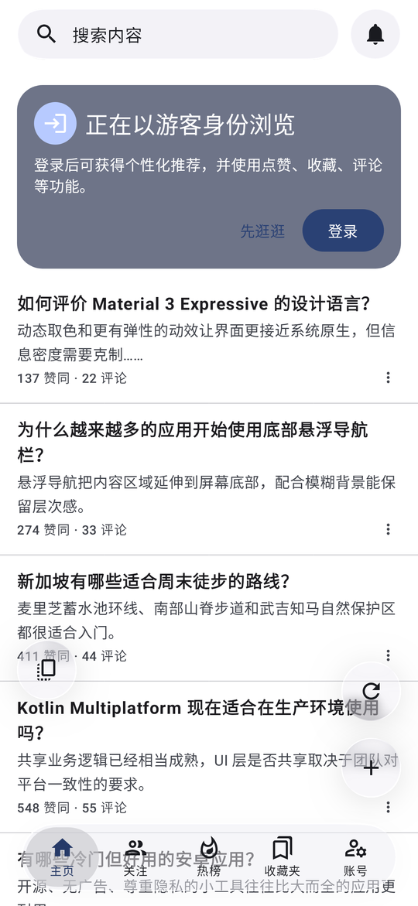
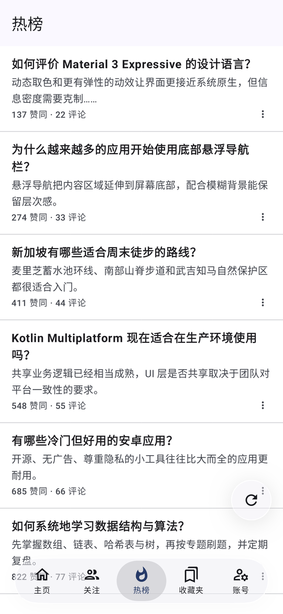
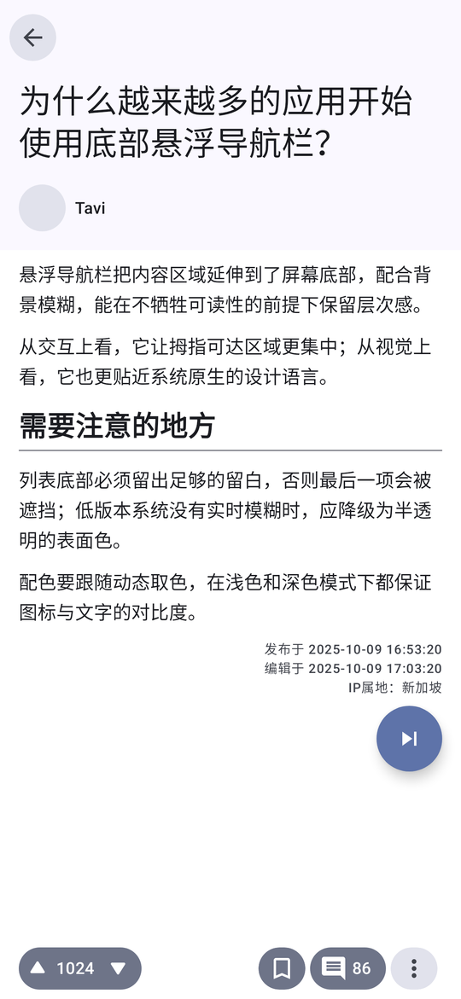
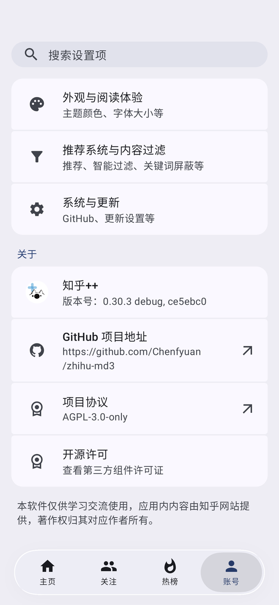
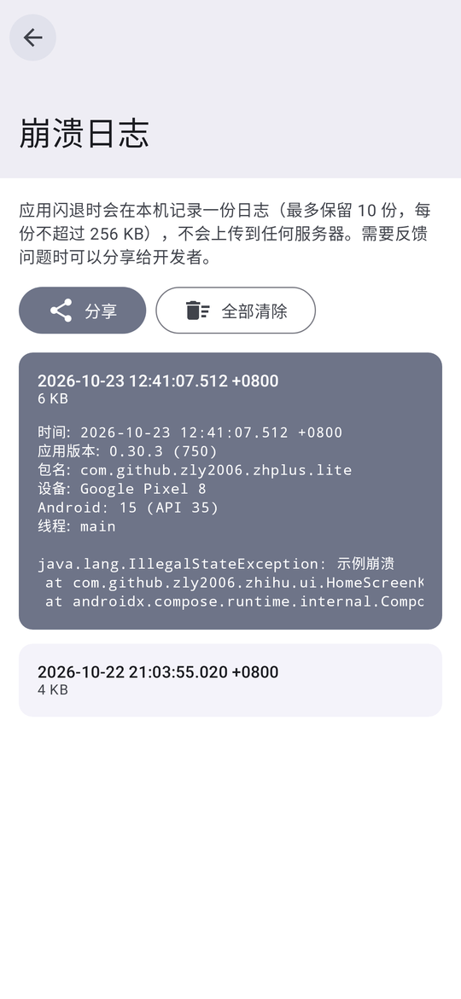

# zhihu-md3

[](https://github.com/Chenfyuan/zhihu-md3/releases)

一个无广告、注重隐私的第三方知乎客户端，以 Android 为主。

本项目是 [zly2006/zhihu-plus-plus（Zhihu++）](https://github.com/zly2006/zhihu-plus-plus) 的分支，绝大部分功能和底层实现来自原项目，感谢原作者 zly2006 及所有贡献者。本项目沿用原项目的 [AGPL-3.0](LICENSE) 许可证，源码文件中的原作者版权声明均保留。

本应用不由知乎官方开发或运营，也未得到知乎的认可或支持。

## 和原项目的区别

- **界面**：按 Material 3 重新设计，底部导航栏、顶部搜索栏和部分操作按钮改为液态玻璃效果，主页、关注、热榜、账号几个页面的底栏效果保持一致。
- **去掉了所有连向原作者服务器的功能**：
  - 使用统计（遥测）
  - 首页在线通知
  - 崩溃日志上传
  - AIGC 标记投票
- **崩溃日志只存在本机**：闪退时在应用私有目录写一份日志，最多保留 10 份，每份不超过 256 KB，不联网。可以在「设置 → 系统与更新 → 崩溃日志」里查看、通过系统分享面板发出去，或者全部清除。
- **检查更新**：从本仓库 [Chenfyuan/zhihu-md3](https://github.com/Chenfyuan/zhihu-md3) 的 GitHub Releases 获取版本。
- **包名**：Android 包名为 `com.sjtech.zhihu`（Full 版为 `com.sjtech.zhihu.full`），可以和原版 Zhihu++ 同时安装，两者的登录状态和设置不互通。

## 应用截图

| 首页 | 热榜 | 回答 | 账号 | 崩溃日志 |
| --- | --- | --- | --- | --- |
|  |  |  |  |  |

截图来自自动化 UI 测试，内容为示例数据。

## 下载

暂未发布。发布后会放在本仓库的 GitHub Releases 页面。

Android 有两个版本：

- **Lite**：体积约 4.5 MB，不含端侧 AI 模型，推荐大多数人使用。
- **Full**：多带一个 ONNX 推理框架，支持基于 embedding 的智能内容过滤（NLP 屏蔽词），体积更大。

仓库里也保留了原项目的桌面端（Windows / Linux / macOS）代码，目前没有在本分支单独维护和发布。

## 主要功能

以下功能沿用自原项目：

- **登录**：手机验证码登录、扫码登录、手动设置 Cookie
- **信息流**：首页推荐支持网页 / 安卓 / 本地 / 混合模式，可以在登录和未登录推荐之间切换；关注、热榜、知乎日报、搜索（热搜、历史、排序与筛选）
- **过滤与屏蔽**：屏蔽词（支持正则）、屏蔽用户、屏蔽话题、屏蔽盐选付费内容、质量过滤、屏蔽记录，屏蔽词可以导入导出；NLP 屏蔽词仅 Full 版可用
- **阅读**：回答、文章、问题、想法、收藏夹、个人主页；沉浸式阅读、回答间手势切换、AI 总结、LaTeX 公式、划线高亮、无水印保存图片、动图与多图查看、应用内播放视频
- **导出**：单篇内容导出为 PDF / 图片 / Markdown / HTML，也可以导出整个收藏夹
- **创作与互动**：写回答（Markdown 编辑、预览、插图、草稿）、评论区、通知、赞同者列表、关注和拉黑用户、经典表情
- **其他**：Deep Link 与剪贴板链接识别、扫码、横滑切换标签页、自定义初始页面、双击点赞或打开评论区

## 隐私

本应用不收集使用数据，也不会把你的浏览内容发到第三方服务器。网络请求只发往知乎，以及以下几处：

- GitHub：检查更新
- 公开的镜像站：首次显示公式时下载数学字体

崩溃日志只保存在手机里，除非你自己分享出去。

## 自行构建

需要 JDK 17 和 Android SDK：

```bash
./gradlew :app:assembleLiteDebug      # Lite 调试包
./gradlew :app:assembleLiteRelease    # Lite 正式包（R8 混淆）
```

Full 版需要单独执行一次 Gradle（Full 和 Lite 不能在同一次调用里构建），并且依赖 Rust 工具链来编译 `sentence_embeddings`。

正式包签名通过环境变量读取：

- `signingKey`：keystore 文件的 Base64
- `keyStorePassword`
- `keyAlias`
- `keyPassword`

不设置的话，正式包不会签名。keystore 和密码请放在仓库之外，不要提交到 Git。

## 相关项目

其他不需要 root 的第三方知乎客户端，与本项目无关：

- [Zhihu++](https://github.com/zly2006/zhihu-plus-plus)（本项目的上游）
- [Hydrogen](https://github.com/zhihulite/Hydrogen)
- [Zhihu--](https://github.com/huamurui/zhihu-minus-minus)
- [Zhihu++ Swift 版（iOS）](https://github.com/kangyun1994/zhihu-plus-plus-swift)
- [Zhihu++ HMOS（鸿蒙版）](https://github.com/zhuoyi233/zhihu-plus-plus-HMOS)

## 许可证

[AGPL-3.0](LICENSE)。本项目基于 Zhihu++（Copyright © 2024-2026 zly2006）修改。
